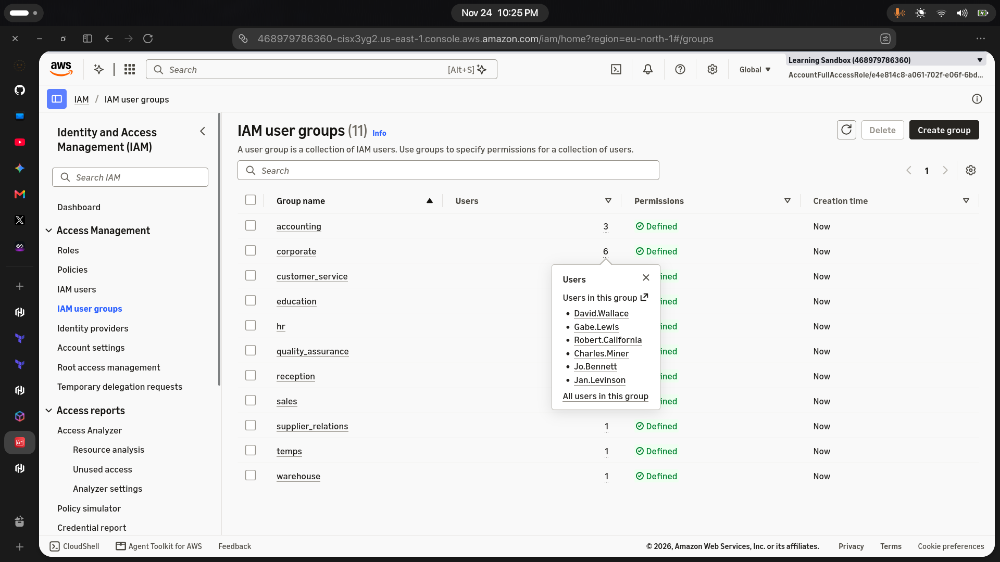

# Terraform IAM Provisioning from CSV

This project reads employee records from `inputs/users.csv` and provisions AWS IAM users, department groups, group memberships, and a policy attachment using Terraform.



## What Was Built

* IAM users created from `inputs/users.csv` (`first_name.last_name` with path `/first_name_last_name/`)
* IAM department groups normalized to lowercase snake_case (`toset` over `department`) with path `/<department>/`
* IAM group memberships mapping users to their department groups
* An IAM policy (`s3-read-only`) allowing `s3:ListAllMyBuckets` attached to every department group
* Remote Terraform state stored in S3 with encryption and lockfile support

## How It Works

`locals` decodes `./inputs/users.csv` using `csvdecode`, builds a map of employees indexed by row position, extracts normalized department names into a set, and groups `first_name.last_name` usernames by department. `for_each` iterates over those locals to create the IAM users, groups, memberships, and policy attachments.

```mermaid
flowchart LR
    CSV["inputs/users.csv<br/>(first_name, last_name, department, job_title)"]
    Locals["locals<br/>employees_map, departments,<br/>employees_group_memberships"]
    PolicyDoc["data.aws_iam_policy_document<br/>s3:ListAllMyBuckets"]

    Users["aws_iam_user.employee_user<br/>first.last (/first_name_last/)"]
    Groups["aws_iam_group.employee_group<br/>department (/department/)"]
    Memberships["aws_iam_group_membership<br/>employee_group_membership"]
    Policy["aws_iam_policy.s3_read_only"]
    Attachment["aws_iam_group_policy_attachment<br/>employee_group_policy_attachment"]
    S3[("S3 Backend<br/>Encrypted + Lockfile")]

    CSV --> Locals
    Locals --> Users
    Locals --> Groups
    Locals --> Memberships
    PolicyDoc --> Policy
    Groups --> Attachment
    Policy --> Attachment
    Users -.->|"Terraform State"| S3
    Groups -.->|"Terraform State"| S3
    Memberships -.->|"Terraform State"| S3
    Policy -.->|"Terraform State"| S3
    Attachment -.->|"Terraform State"| S3
    ```
